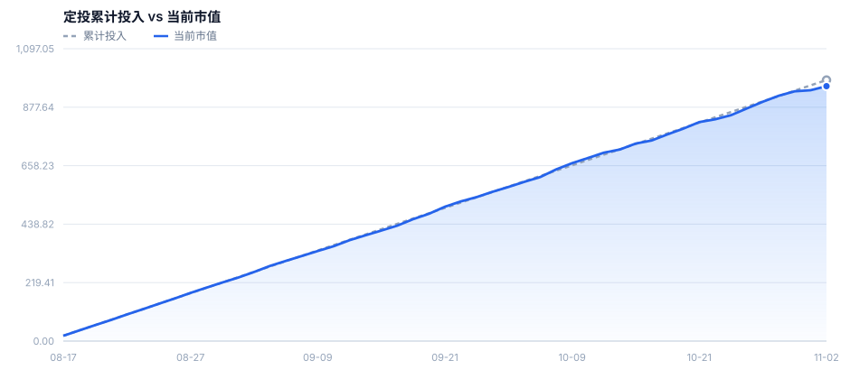

# 标普500指数基金每日定投

> 自动跟踪标普500指数基金（QDII）每日定投。数据取自天天基金披露的官方净值与申购状态，由 GitHub Actions 自动更新。

**仓库**：https://github.com/SayangChun/sp500-dca
**在线看板**：https://sayangchun.github.io/sp500-dca/

## 当前状态

- **开始定投**：2026-08-17（持续定投，无终止日期）
- **最新净值日**：2026-11-05
- **实际定投交易日**：52 天
- **因暂停申购跳过**：1 天
- **累计投入**：¥1,039.48
- **当前市值**：¥993.54
- **累计盈亏**：¥-45.94（-4.42%）

## 持仓明细

| 基金 | 代码 | 每日定投 | 定投交易日 | 投入本金 | 持有份额 | 成本净值 | 最新净值 | 当前市值 | 累计盈亏 | 收益率 |
|:---|:---:|:---:|:---:|---:|---:|---:|---:|---:|---:|---:|
| 摩根标普500 A | 017641 | ¥9.99 | 52 | ¥519.48 | 305.67 | 1.6995 | 1.6246 | ¥496.59 | ¥-22.89 | -4.41% |
| 摩根标普500 C | 019305 | ¥10.00 | 52 | ¥520.00 | 308.97 | 1.6830 | 1.6084 | ¥496.95 | ¥-23.05 | -4.43% |
| **合计** | — | ¥19.99 | 52 | **¥1,039.48** | **614.64** | — | — | **¥993.54** | **¥-45.94** | **-4.42%** |

## 定投曲线

## 最近记录

| 申购日 (T) | 份额确认日 (T+2) | 单位净值 | 累计投入 | 当前市值 | 累计盈亏 |
|:---|:---:|---:|---:|---:|---:|
| 2026-11-05 | 待确认 | 1.6246 | ¥1,039.48 | ¥993.54 | ¥-45.94 |
| 2026-11-04 | 2026-11-06 | 1.6937 | ¥1,019.49 | ¥1,014.95 | ¥-4.54 |
| 2026-11-03 | 2026-11-05 | 1.6682 | ¥999.50 | ¥979.97 | ¥-19.53 |
| 2026-11-02 | 2026-11-04 | 1.6624 | ¥979.51 | ¥956.64 | ¥-22.87 |
| 2026-10-30 | 2026-11-03 | 1.6706 | ¥959.52 | ¥941.31 | ¥-18.21 |
| 2026-10-29 | 2026-11-02 | 1.6997 | ¥939.53 | ¥937.36 | ¥-2.17 |
| 2026-10-28 | 2026-10-30 | 1.7055 | ¥919.54 | ¥920.49 | ¥+0.95 |
| 2026-10-27 | 2026-10-29 | 1.7013 | ¥899.55 | ¥898.30 | ¥-1.25 |
| 2026-10-26 | 2026-10-28 | 1.6913 | ¥879.56 | ¥873.12 | ¥-6.44 |
| 2026-10-23 | 2026-10-27 | 1.6811 | ¥859.57 | ¥848.00 | ¥-11.57 |

## 非投资日说明

以下交易日因基金**暂停申购**，当日定投未执行：

| 日期 | 当日申购状态 | 涉及基金 | 当日单位净值 |
|:---|:---|:---|---:|
| 2026-09-07 | 暂停申购 | 摩根标普500 A、摩根标普500 C | 摩根标普500 A 1.7152 / 摩根标普500 C 1.6989 |

## 休市日说明

以下工作日为**法定节假日休市**（非交易日），场外基金不受理申购，当日定投未执行：

| 日期 | 假期 | 休市工作日 |
|:---|:---|---:|
| 2026-09-25 | 中秋节 | 1 天 |
| 2026-10-01 ~ 2026-10-07 | 国庆节 | 5 天 |

## 定投规则（按境内基金实际开放申购口径）

1. **投资日**：仅在该基金为交易日的当天执行；非交易日不申购。
2. **申购状态**：仅当该交易日「开放申购」时执行；公告「暂停申购」的交易日一律不执行。
3. **申购时段**：交易日 9:30–15:00；15:00 前提交的申请视为当日（T 日）。
4. **确认规则**：QDII 基金按 **T 日单位净值**确认份额，**T+2 个交易日**确认。
5. **份额计算**：净申购金额 = 定投金额 ÷ (1 + 申购费率)；份额 = 净申购金额 ÷ T 日单位净值，四舍五入保留 **2 位小数**。

- 摩根标普500指数(QDII)人民币A（017641）：每个可申购交易日 ¥9.99，免申购费，单日累计购买上限 ¥10
- 摩根标普500指数(QDII)人民币C（019305）：每个可申购交易日 ¥10.00，免申购费，单日累计购买上限 ¥10
- 起投日：2026-08-17，无终止日期。

## 净值披露节奏

- 基金净值通常为 **T+1 晚间**披露：净值日 D 的数据一般在 D+1 的 20:00~23:00（北京时间）才出现。
- 周末与节假日不产生净值，因此本仓库可能连续 2~3 天没有新提交，属正常现象。

## 数据与自动化

- 净值数据源：天天基金（东方财富）历史净值 + 申购状态（https://fund.eastmoney.com/）
  - 017641 申购状态：天天基金历史净值列表接口
  - 019305 申购状态：天天基金历史净值列表接口
- 更新方式：GitHub Actions **每小时**轮询，自动抓取净值与申购状态、重算持仓并提交结果；数据无变化时不产生提交。
- 看板页面：`reports/index.html`（在线看板见上方链接）。

---
最后更新：2026-11-06 23:39 (UTC+8)

*本仓库仅用于个人投资记录，不构成任何投资建议。*
